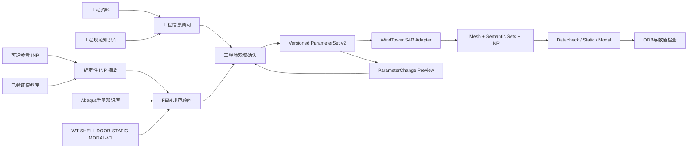

# GitHub v1 架构

## 四阶段主线

四个宏观阶段依次为“双通道候选形成、工程师确认、确定性生成、验证与求解”；桌面端为便于操作，将生成与求解分别展示，因此界面上呈现五个连续步骤。

## 服务职责

- `EngineeringInputBatchService`：多文件提取、双域候选编排、冲突和工程师确认。
- `input_batches.lifecycle`：旧批次迁移、进程中断诊断、可重试状态和状态机收口。
- `input_batches.reference_storage`：参考 INP 暂存与原子替换，防止失败更新删除旧参考。
- `ReferenceModelService`：确定性解析参考 INP，并生成受能力约束的 FEM 规范候选。
- `EngineeringAdvisor` 与 `FemAdvisor`：独立 Qwen 配置、提示词、知识检索和用量审计，不跨域写值。
- `ModelLibraryService`：显式发布不可变模型版本，保存 ParameterSet、FEM 规范、参考 INP 校验和与验证等级。
- `Modeling Capability Profile`：固定当前结构族、可编辑 FEM 参数和不支持特征。
- `ParameterService`：唯一正式参数集、revision、修改预览和原子确认。
- `ModelGenerationService`：参数门禁、S4R 网格、集合及确定性 INP。
- `ValidationService`：Datacheck、显式求解、任务隔离、ODB 与结果。
- `WindTowerPipeline`：仅保留轻量输入映射编排，不承载生成和求解职责。

## 三层验证

1. 参数门禁：类型、单位、范围、依赖、完整性和确认状态。
2. 模型门禁：网格质量、集合引用、截面、分析步、静态 INP 检查和 Datacheck。
3. 数值检查：质量、反力、位移、频率、ODB 完整性和网格敏感性。

## v1 公共 API

- `/api/health`、`/api/desktop/*`
- `/api/input-batches/*`
- `GET /api/modeling-capabilities/current`
- `PUT|DELETE /api/input-batches/{id}/reference-model`
- `POST /api/input-batches/{id}/fem-specification/confirm`
- `POST /api/input-batches/{id}/engineering-review/confirm`
- `POST /api/input-batches/{id}/reference-model/select`
- `GET /api/model-library`
- `POST /api/projects/{id}/model-library/publish`
- `GET /api/knowledge-bases/status`
- `GET /api/projects/{id}/parameters`
- `POST /api/projects/{id}/parameter-changes/preview`
- `POST /api/projects/{id}/parameter-changes/confirm`
- `POST /api/projects/{id}/validate|mesh|build|datacheck`
- `POST /api/projects/{id}/submissions`
- `GET /api/projects/{id}/submissions/{submission_id}`
- `POST /api/projects/{id}/postprocess`
- `GET /api/projects/{id}/results`

参考 INP 不进入编译入口。`preview_id + base_revision` 阻止过期修改，编译器只读取服务器端已确认参数集。
